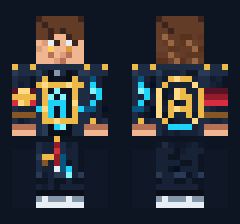

# Modern Owner — Minecraft Admin Skin

A **real, importable 64×64 Minecraft skin** for the classic (wide-arm) model. Modern server-owner look: medium-brown hair, amber eyes, understated gold circlet, tailored black hoodie-jacket, restrained cyan details, black trousers and sneakers.

## Actual skin — not concept art

- [**Modern_Owner_Admin_64x64.png**](./Modern_Owner_Admin_64x64.png): the real Minecraft classic skin texture (64×64 PNG). This is the file to use with skin mods.
- [**Modern_Owner_Real_Front.png**](./Modern_Owner_Real_Front.png): a pixel-accurate front view composited from the real skin's base and outer layers (enlarged in the README).
- [**Original stylized design**](./concepts/modern-owner-concept-art.png) and [**original rendered preview**](./concepts/modern-owner-stylized-preview.png): archived concept/reference artwork, **not usable skin textures**. The game's normal skin model cannot reproduce cinematic lighting or flowing 3D outfits.



## Finish and backup

The current skin has subtle satin-style highlights on the dark jacket and pants, brighter gold trim, and slightly more hair definition. These are texture details, **not actual reflective materials**; true shininess depends on client-side shaders/material support.

The previous matte version is archived at [`skins/archive/Modern_Owner_Matte_64x64.png`](./skins/archive/Modern_Owner_Matte_64x64.png).

## PS5 on a Fabric/Geyser server

For the *Suiranoil SkinRestorer* Fabric mod, use the direct PNG URL below:

```text
https://raw.githubusercontent.com/Rkkicks123/minecraft-admin-skin/main/Modern_Owner_Admin_64x64.png
```

In the **server console** (omit the leading `/`), while your Bedrock player is online:

```text
skin set web classic "https://raw.githubusercontent.com/Rkkicks123/minecraft-admin-skin/main/Modern_Owner_Admin_64x64.png" .MegBoyz
```

If your Floodgate configuration uses a different username prefix, replace `.MegBoyz` with the exact in-server name.

**Important:** A server-assigned skin may be visible to Java players but is not guaranteed to appear on the PS5 owner's own Bedrock screen. Skin caching can also delay updates. PS5 does not support arbitrary PNG skin import directly.

**No Minecraft world or server reset is needed** when switching skins.
